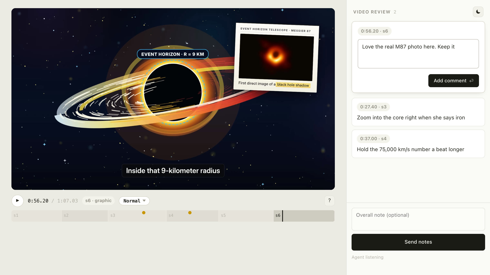
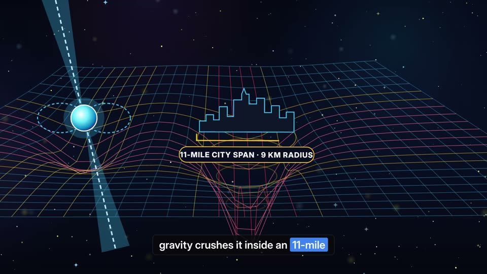
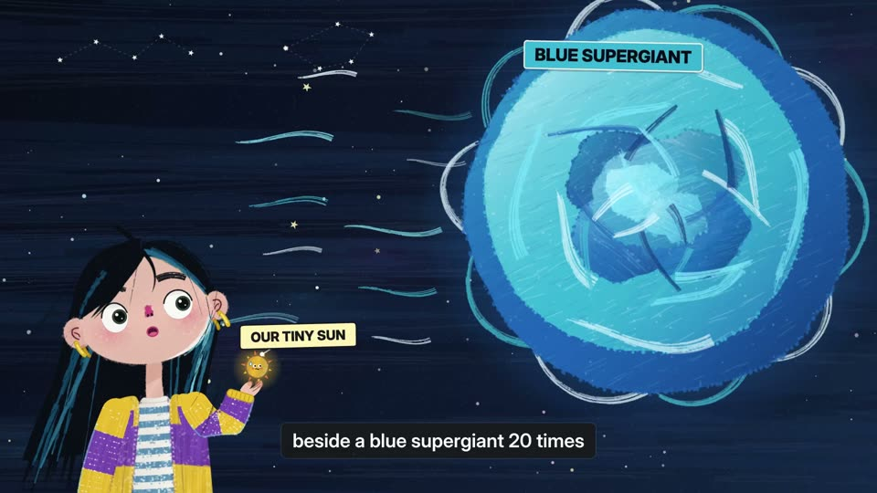
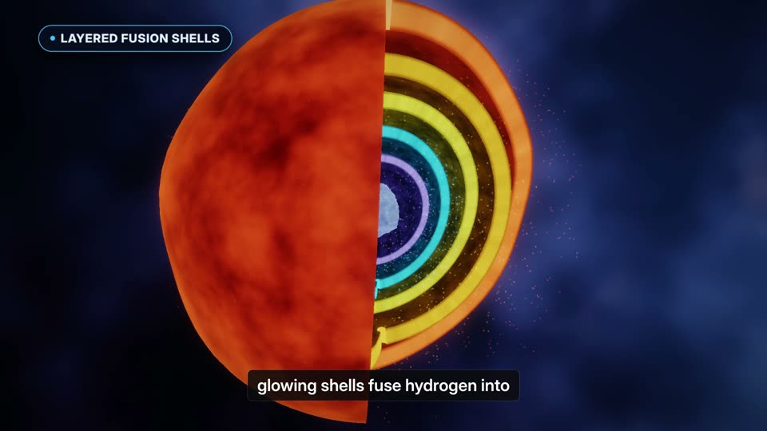

# Video Explainer

Turn any topic, doc, codebase, or URL into a crisp 1-minute explainer video with custom visuals, web media, voiceover, captions, and music using Claude, ChatGPT, Gemini, or your favorite agent.

https://github.com/user-attachments/assets/bdcc1496-7e1d-4956-844c-dab2d64c10b5

[Watch the full tutorial](https://youtu.be/7I8B7CQky0Y) or [read the step-by-step guide](https://creatoreconomy.so/p/gemini-4-neon-and-antigravity-full-course) to see how I built this skill.

## Problem

Great explainer videos make hard ideas click in 60 seconds, but building one by hand in After Effects or Blender takes days. And when you ask AI to help, most tools spit out static slide decks or garbled text, and giving frame-accurate feedback in chat is painful.

## What video explainer can do

/video-explainer makes it easy to iterate with AI to create custom, code-driven explainers (~60 to 75 seconds by default or any length you ask for, written in plain English for a smart non-engineer). The best part of the skill is it gives you a review page to give feedback to your AI agent on any frame until the video feels right:

<picture>
  <source media="(prefers-color-scheme: dark)" srcset="assets/review-dark.jpg">
  
</picture>

The skill supports making explainers in 3 visual styles:

1. **Motion (default):** High-energy 2D kinetic graphics, live charts and routes, press clippings, and 3D device cards.
2. **Illustrated:** Hand-drawn picture-book animation with gouache, dry pastel, paper grain, 10 fps line boil, and speaking characters.
3. **3D:** Single-take Three.js camera flythroughs with studio lighting, reflections, bloom, and optional Blender meshes.

Here's `/video-explainer how do black holes form` in each style:

| Motion | Illustrated | 3D |
|---|---|---|
|  |  |  |

Motion is the fastest and cheapest. Illustrated and 3D look richer but use about 6 to 7 times as many tokens.

It can also add the following automatically:

- **Captions** that match the voiceover word for word, or none if you turn them off.
- **Web media, screenshots, and quotes** pulled online with source attribution to ground what you're explaining.
- **Voiceover (optional)** generated free on your computer with Kokoro, in the cloud with Gemini TTS, or skipped for music-only videos.
- **Music and sound effects** synthesized locally and synced to key words, or generated with Gemini Lyria using a [Gemini API key](https://aistudio.google.com/?utm_source=peteryang&utm_medium=partner&utm_campaign=26Q3-peteryang_ais) with billing enabled.

## How to install video explainer

The skill runs on your computer, so use an agent that can run commands there:

- **Claude:** Claude Code, in the terminal or the Code tab of the Claude desktop app.
- **ChatGPT:** The ChatGPT desktop app or the Codex app.
- **Others:** Cursor, Antigravity, or any agent that supports skills.

It works on macOS and Linux (on Windows, use WSL). The web versions of Claude and ChatGPT can't run it, since they can't reach the video tools on your computer.

To install the skill, just paste this into your agent:

```text
Install the /video-explainer skill globally from https://github.com/petergyang/video-explainer
```

You can also install it with `npx`:

```sh
npx skills add petergyang/video-explainer --skill video-explainer --global --yes
```

To update to the latest version later, run the same install again.

The first time you run the skill, it'll check if you have the following installed and offer to install what's missing. Plan for around 400 MB of disk space (or ~1.4 GB if you enable local voiceover):

- **[ffmpeg](https://ffmpeg.org)** to mix audio and encode video.
- **[Python](https://www.python.org) 3.10 or newer** to run the pipeline scripts.
- **[Node.js](https://nodejs.org) 22 or newer** for [HyperFrames](https://github.com/heygen-com/hyperframes), the free, open-source tool that renders HTML, Canvas, and WebGL into 1080p video and aligns speech on your computer with the [Parakeet](https://huggingface.co/nvidia/parakeet-tdt-0.6b-v3) model.
- **Optional: [yt-dlp](https://github.com/yt-dlp/yt-dlp)** to pull web video clips, and **[Blender](https://www.blender.org)** to sculpt or fracture custom 3D meshes.
- **Optional: A Gemini API key** with billing enabled, to generate expressive voiceover with Gemini TTS and music with Lyria. Get a key at [Google AI Studio](https://aistudio.google.com/?utm_source=peteryang&utm_medium=partner&utm_campaign=26Q3-peteryang_ais) and set `GEMINI_API_KEY` in `~/.config/video-explainer/.env`.

## How to use video explainer

I've made this skill as simple as possible to use, just follow these 4 steps:

1. **Install.** Paste the install prompt above into Claude Code, the ChatGPT desktop app, or another agent from the list. You only do this once.
2. **Prompt.** Give the skill any topic, doc, codebase, or URL:

   ```text
   /video-explainer explain how black holes form
   ```

3. **Pick a style.** Choose **Motion** (default), **Illustrated**, or **3D**, and whether you want captions. You can also ask for ELI5, technical depth, a different length, silent mode, or vertical `9:16`. Your agent verifies the facts, writes the script, generates voiceover and visuals, and runs 10 automated QA checks. Before you see a draft, a second agent reviews the frames and sends back anything that looks like a slide deck or clip art.
4. **Iterate.** Once your agent finishes a draft, it opens the review page in your browser so you can play the video, pause on any frame, and leave feedback. The agent applies your feedback and reloads the review page with a new version until it feels right.

Each draft saves a single 1080p MP4 and keeps only the version before it, so you can compare the last two without filling up local storage (pass `--share` if you also want a small 720p copy in `renders/share/`). The final render replaces every earlier draft.

## Make it yours

Fonts, colors, themes (`default`, `paper`, `blueprint`), and caption style come from a small `style.json`. Save yours at `~/.config/video-explainer/style.json` and every explainer uses it. The keys are in [`reference.md`](skills/video-explainer/reference.md).

## What's inside

- [`SKILL.md`](skills/video-explainer/SKILL.md) contains the workflow and visual craft rules.
- [`reference.md`](skills/video-explainer/reference.md) contains the commands, the `script.md` format, the 3 visual engines, and style options.
- [`eval.md`](skills/video-explainer/eval.md) contains the checks the skill runs before handing back a video.
- [`assets/`](skills/video-explainer/assets) contains the built-in engines for Motion (`stage.js`, `stage.css`), Illustrated (`illustrated.js`), and 3D (`studio3d.js`).
- [`scripts/`](skills/video-explainer/scripts) contains the scripts for setup, media fetching, voiceover, sound design, Blender export, rendering, the review page, and QA.

## Want more great AI skills?

Become a paid member at [Behind the Craft](https://behindthecraft.com) to get all my AI skills, $600+ in AI tool discounts, and my personal AI course.

Subscribe to my [YouTube channel](https://www.youtube.com/@PeterYangYT?sub_confirmation=1) and [newsletter](https://creatoreconomy.so) for practical AI tutorials and interviews.

## License

MIT. The bundled Inter font is under the [SIL Open Font License](skills/video-explainer/fonts/OFL.txt).
